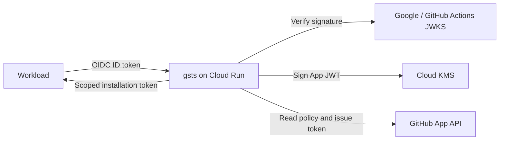

# gsts

Exchange Google Cloud workload identity for scoped GitHub App installation tokens.

**Status: pre-release.** `v0.1.0-alpha.2` passed a live Cloud Run / Cloud KMS / GitHub acceptance test of its core exchange, policy and revocation paths ([record](docs/acceptance.md)). Not yet done: an independent security review, rate-limit boundary load testing, KMS/GitHub fault-injection testing and long-running soak testing. The v0.2 features on the development branch (replay prevention, organization trusted issuers, `claim`) have not been live-tested. No production deployment is assumed.

A workload sends an OIDC ID token to gsts. gsts verifies it, reads a trust policy from the target repository's default branch, and returns an installation access token. Google service accounts and GitHub Actions are supported.



The runtime is one Go binary in one container. There is no database, webhook service, or eventing dependency. Cloud KMS holds the GitHub App's imported signing key; application instances only receive signatures. Callers never need that key.

## Container image

Release images are published to `ghcr.io/sakajunquality/gsts` for `linux/amd64` and `linux/arm64` by the [Release image workflow](https://github.com/sakajunquality/gsts/actions/workflows/image.yml). Use an explicit version tag from a successful run; `latest` is updated only for stable releases. Alpha/beta/RC tags are intended for live acceptance testing and do not imply production readiness.

```sh
# After the corresponding release workflow succeeds:
docker run --rm ghcr.io/sakajunquality/gsts:v0.1.0-alpha.2 version
```

The workflow summary includes the image digest. Use `ghcr.io/sakajunquality/gsts@sha256:...` in deployment configuration to pin the exact tested image. See [the deployment runbook](docs/deployment.md) for Cloud Run and KMS setup.

## Quick example

Put `.github/gsts/deploy.sts.toml` on the target repository's default branch:

```toml
[google]
service_account = "deploy@my-project.iam.gserviceaccount.com"

[permissions]
contents = "read"
pull_requests = "write"
```

From a workload with that service account and access to the Google metadata server:

```sh
GSTS_URL=https://YOUR-SERVICE.run.app
GSTS_AUDIENCE=https://gsts.example.com
ID_TOKEN=$(curl --fail --silent --show-error --get \
  -H 'Metadata-Flavor: Google' \
  --data-urlencode "audience=$GSTS_AUDIENCE" \
  --data-urlencode 'format=full' \
  'http://metadata.google.internal/computeMetadata/v1/instance/service-accounts/default/identity')
curl --fail-with-body --silent --show-error "$GSTS_URL/token" \
  -H "Authorization: Bearer $ID_TOKEN" \
  -H 'Content-Type: application/json' \
  -d '{"scope":"example-org/infra","identity":"deploy"}'
```

```json
{"token":"ghs_...","expires_at":"2026-09-25T10:00:00Z","permissions":{"contents":"read","metadata":"read","pull_requests":"write"}}
```

`GSTS_AUDIENCE` must match the server's `GSTS_IDENTIFIER` (or a policy audience explicitly listed in `GSTS_ALLOWED_AUDIENCES`). It can differ from the endpoint URL. Do not log the response token.

## Deploy

See [Cloud Run deployment](docs/deployment.md) for the complete bootstrap, import, and rotation procedure. The [Terraform module](terraform/google/README.md) creates only Cloud Run, a KMS key ring and import-only key, a runtime service account, and IAM bindings.

A GitHub App private key is required to issue installation tokens. Generate it in GitHub and import the downloaded PEM into KMS with `gsts kms-import`. **The key exists outside KMS during initial generation/import; after import, the runtime never exports it.** This is not a fully keyless GitHub authentication scheme. See [GitHub's key documentation](https://docs.github.com/en/apps/creating-github-apps/authenticating-with-a-github-app/managing-private-keys-for-github-apps).

```sh
go build -trimpath -o bin/gsts ./cmd/gsts
bin/gsts kms-import projects/PROJECT/locations/REGION/keyRings/gsts/cryptoKeys/gsts ./app.pem
```

The import command uses Application Default Credentials, prints the enabled key version resource name, and leaves the input file untouched. It wraps PKCS#8 in memory with RSA-OAEP-SHA256 + AES-256-KWP; it does not write another plaintext key file. Remove the original PEM and any copies after verifying the import.

## Policies and API

- [Trust policies](docs/policies.md): Google shorthand, org policies, audiences, claim matching, and narrowing.
- [Organization trusted issuers](docs/policies.md#organization-trusted-issuers): opt-in org-level issuer allowlist (`GSTS_ORG_TRUST_FILE`).
- [HTTP API](docs/api.md): request/response formats and stable error reasons.
- [Configuration](docs/configuration.md): all environment variables.
- [Design decisions](docs/design.md): compatibility boundaries and adjustments to the initial proposal.
- [Live acceptance record](docs/acceptance.md): what was and was not verified for `v0.1.0-alpha.2`.
- [Migrating from sts-cat](docs/migration-sts-cat.md): policy differences and a step-by-step guide.
- [Security](SECURITY.md): authorization boundaries, operational responsibilities, and disclosure.

Org scope reads policies from the organization's `.github` repository. `repositories` is a **root TOML field** and goes before `[google]`:

```toml
repositories = ["infra", "api"]

[google]
project = "my-ci-project"

[permissions]
contents = "read"
```

Omitting an org policy's `repositories` permits all repositories accessible to the installation. Prefer an explicit list. Only org-level policies can grant organization permissions such as `members`.

## Shared client and policy tools

Use the [official GitHub Action](action/README.md) as `sakajunquality/gsts/action@<commit SHA>` for OIDC exchange, token masking and post-job revocation. Pass the gsts URL/audience for the target environment. Apps, KMS keys and services remain isolated by environment.

Use [`gsts policy validate/test`](docs/policy-cli.md) in CI to check policy syntax and allow/deny fixtures, including caller and reusable workflow references. For operational monitoring use [`/live` and `/ready`](docs/health.md); `/healthz` is no longer served. Configure [admission limits and diagnostics](docs/api.md#admission-and-retry-controls) before rollout.

## Local development

Requires Go 1.27.2 or later. The Terraform module requires Terraform 1.6 or later; mocked plan tests require Terraform 1.7 or later.

```sh
cp .env.example .env
# Edit .env with your App ID, key path, and allowed orgs.
set -a
. ./.env
set +a
go run ./cmd/gsts serve
```

`file` and `env` signing are development-only and require `GSTS_ALLOW_INSECURE_KEY=1`. For `env`, `GSTS_KEY_ENV` names the environment variable containing the PEM. There is no unauthenticated development bypass for ID-token verification.

To obtain a service account ID token locally, use an account authorized to impersonate the caller service account:

```sh
gcloud auth print-identity-token \
  --impersonate-service-account=deploy@my-project.iam.gserviceaccount.com \
  --audiences=http://localhost:8080 --include-email
```

A plain user credential is not a substitute for the service account configured in the policy. Runtime metadata support also depends on the calling product and identity configuration; gsts has no product-specific token validation branches.

```sh
make check
make build
make image
docker run --rm gsts:dev version
```

Tests use generated RSA keys, in-process HTTP fixtures, and a fake KMS signer; they need no cloud credentials. [CONTRIBUTING.md](CONTRIBUTING.md) describes the checks and release process.

## Credits and license

Inspired by [octo-sts](https://github.com/octo-sts/app) and [sts-cat](https://github.com/sorah/sts-cat). The HTTP exchange shape and base TOML vocabulary follow sts-cat; the default path is `.github/gsts`, and Go regex semantics and strict parsing have [documented differences](docs/design.md). This is an independent Go implementation, not a port of either project's code.

Apache-2.0. See [LICENSE](LICENSE).
